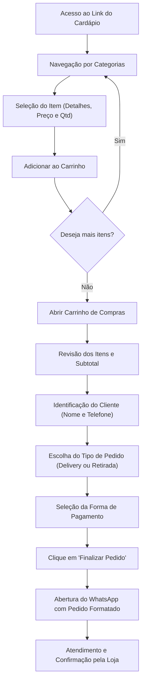

# Especificação de Escopo: Cardápio Digital com Pedidos via WhatsApp

## 1. Visão Geral do Projeto

O objetivo deste projeto é desenvolver uma aplicação web de **Cardápio Digital Responsivo (Mobile-First)** voltada para estabelecimentos comerciais (restaurantes, lanchonetes, confeitarias, hamburguerias, etc.). 

A solução permite que os clientes visualizem os produtos organizados por categorias, adicionem itens ao carrinho com observações personalizadas, informem seus dados de entrega/retirada, escolham o método de pagamento e finalizem a compra. Ao concluir, o sistema compila todas as informações em uma mensagem clara e padronizada e redireciona o cliente diretamente para o **WhatsApp oficial da loja**.

---

## 2. Jornada do Cliente (Fluxo de Uso)



---

## 3. Requisitos Funcionais (RF)

### 3.1. Exibição e Navegação do Cardápio
- **RF01 - Divisão por Categorias:** Os produtos devem ser organizados em abas ou seções visuais (ex.: *Entradas*, *Lanches*, *Bebidas*, *Sobremesas*, *Combos*).
- **RF02 - Card do Produto:** Cada produto deve exibir:
  - Nome do item;
  - Descrição detalhada (ingredientes, peso ou porção);
  - Preço formatado em R$;
  - Foto do produto (opcional/recomendado);
  - Indicador de status (disponível ou esgotado).
- **RF03 - Busca e Filtros rápidos:** Barra de pesquisa por nome de produto e rolagem automática ao clicar na categoria.

### 3.2. Gerenciamento do Carrinho
- **RF04 - Adição com Customização:** Ao selecionar um item, o cliente pode:
  - Ajustar quantidade (mínimo 1);
  - Inserir observação específica (ex.: *"sem cebola"*, *"molho à parte"*).
- **RF05 - Drawer / Modal do Carrinho:**
  - Listagem de itens adicionados com suas respectivas quantidades, valores e observações;
  - Botões para alterar quantidade (+ / -) ou remover item;
  - Cálculo automático de subtotal em tempo real;
  - Persistência temporária (se o cliente recarregar a página, os itens continuam no carrinho via `LocalStorage`).

### 3.3. Checkout e Finalização do Pedido
- **RF06 - Identificação do Cliente:**
  - Nome completo;
  - Telefone de contato / WhatsApp.
- **RF07 - Modalidade de Entrega:**
  - **Entrega (Delivery):** Exige preenchimento de endereço (Rua, Número, Bairro, Complemento e Ponto de Referência).
  - **Retirada no Balcão:** Não exige endereço residencial.
- **RF08 - Formas de Pagamento:**
  - **Pix:** (Informa se será chave Pix enviada no WhatsApp ou QR Code);
  - **Cartão (Crédito / Débito):** Levar maquininha na entrega;
  - **Dinheiro:** Campo opcional de *"Precisa de troco para quanto?"*.
- **RF09 - Observações Gerais do Pedido:** Campo livre para recados adicionais ao estabelecimento.

### 3.4. Integração com WhatsApp
- **RF10 - Geração da Mensagem:** Construtor de texto com codificação URL (`encodeURIComponent`) que formata os dados com emojis e divisores para leitura limpa.
- **RF11 - Disparo do Pedido:** Redirecionamento direto para a API oficial do WhatsApp (`https://wa.me/55DDDNUMERO?text=...`).

---

## 4. Requisitos Não-Funcionais (RNF)

- **RNF01 - Mobile-First:** Interface 100% pensada para telas de smartphones, com botões de toque generosos e barra flutuante de carrinho.
- **RNF02 - Velocidade de Carregamento:** Carregamento rápido (< 2 segundos), leve e sem necessidade de cadastro/senha obrigatória prévia para não gerar abandono de carrinho.
- **RNF03 - Compatibilidade:** Funcionar nos navegadores modernos (Chrome, Safari, Firefox, Edge) tanto em iOS quanto em Android.
- **RNF04 - Facilidade de Manutenção do Cardápio:** Dados dos produtos estruturados de forma modular (arquivo JSON, banco de dados ou painel simples) para que alterações de preço ou produtos não exijam reescrita de código.

---

## 5. Estrutura da Mensagem Enviada ao WhatsApp

A mensagem gerada ao clicar em **"Finalizar Pedido"** seguirá o seguinte padrão:

```text
🍔 *NOVO PEDIDO RECEBIDO!*
--------------------------------
👤 *Cliente:* Lucas Silva
📱 *Telefone:* (11) 98765-4321

📦 *Tipo:* Entrega (Delivery)
📍 *Endereço:* Rua das Flores, 123 - Apto 42
📍 *Bairro:* Centro
📍 *Ref:* Próximo ao supermercado

--------------------------------
📋 *ITENS DO PEDIDO:*

• 2x Burger Duplo Bacon (R$ 32,00 cada)
  _Obs: Um deles sem cebola_
• 1x Batata Frita Rústica (R$ 18,00)
• 2x Refrigerante Lata 350ml (R$ 6,00 cada)

--------------------------------
💰 *Subtotal:* R$ 94,00
💳 *Forma de Pagamento:* Dinheiro
💵 *Troco para:* R$ 100,00

📝 *Obs. do Pedido:* Tocar o interfone 42 por favor.
--------------------------------
⏰ Pedido enviado via Cardápio Digital
```

---

## 6. Modelo de Dados Sugerido

```typescript
// Categoria de Produtos
interface Category {
  id: string;
  name: string;      // Ex: "Lanches", "Bebidas"
  order: number;     // Ordem de exibição
}

// Produto
interface Product {
  id: string;
  categoryId: string;
  name: string;
  description: string;
  price: number;
  imageUrl?: string;
  isAvailable: boolean;
}

// Item no Carrinho
interface CartItem {
  product: Product;
  quantity: number;
  notes?: string;
  itemTotal: number;
}

// Informações do Checkout
interface CheckoutData {
  customerName: string;
  customerPhone: string;
  orderType: 'delivery' | 'pickup';
  address?: {
    street: string;
    number: string;
    neighborhood: string;
    complement?: string;
    reference?: string;
  };
  paymentMethod: 'pix' | 'credit' | 'debit' | 'cash';
  changeFor?: number; // Troco se dinheiro
  generalNotes?: string;
}
```

---

## 7. Roadmap de Entrega Sugerido

### 🔹 Fase 1: MVP (Produto Mínimo Viável)
- [x] Criação da interface com categorias e cards de produtos.
- [x] Carrinho interativo com cálculo dinâmico de totais.
- [x] Formulário de entrega e pagamento.
- [x] Integração completa com link do WhatsApp.

### 🔹 Fase 2: Gestão e Autonomia da Loja
- [ ] Painel administrativo simples para cadastrar, editar preços e pausar produtos esgotados.
- [ ] Configuração de taxa de entrega (fixa ou por bairro).
- [ ] Horário de funcionamento com aviso de "Loja Aberta" ou "Loja Fechada".

### 🔹 Fase 3: Recursos Avançados
- [ ] Adicionais/Opcionais nos produtos (ex.: *"Adicionar queijo extra + R$ 3,00"*).
- [ ] Pagamento Pix automático (geração de QR Code e Pix Copia e Cola).
- [ ] Histórico de pedidos no painel para controle interno da cozinha.
